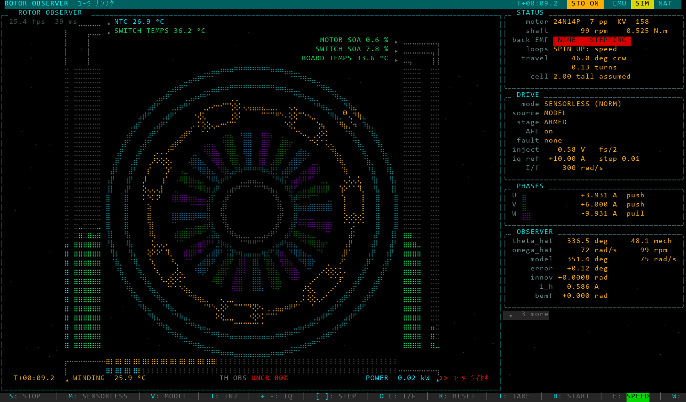
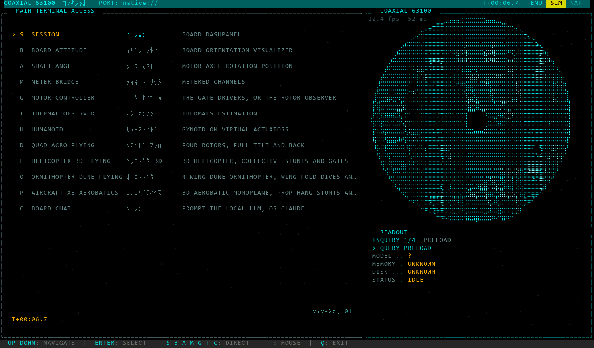
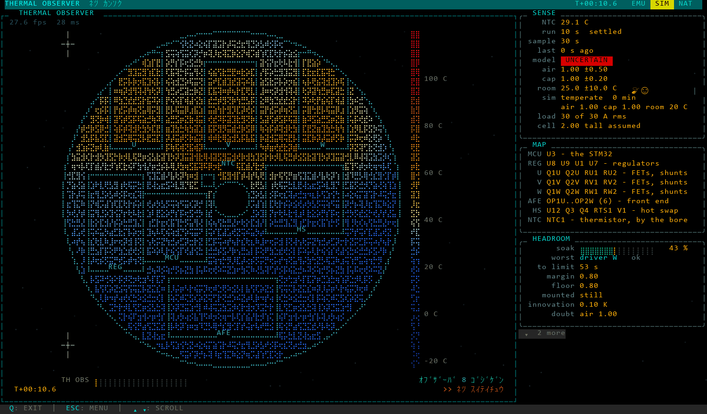
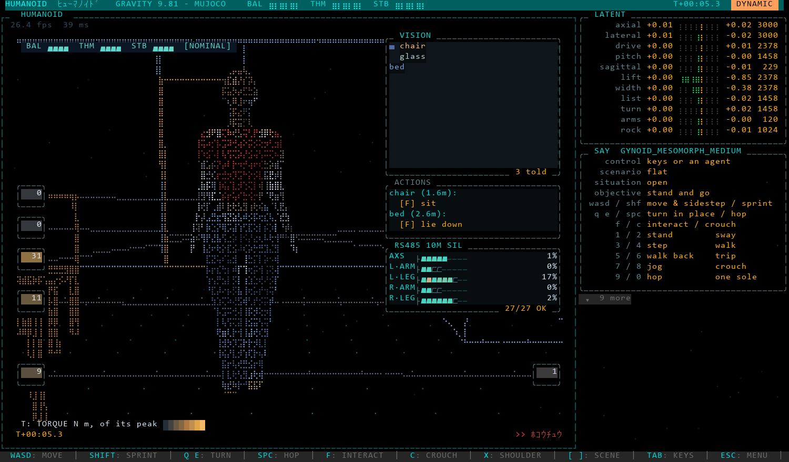

# Coaxial 63100

A three-phase BLDC inverter whose PCB sits coaxially behind an outrunner's
stator - 63 V, 100 A, an STM32H753VIT6 at 475 MHz - its firmware (the
application and a bootloader), the Python host that drives a board or
sequences boards into machines, and the emulation that runs the firmware with
no board. *Coaxial* is the placement: no coax cable or connector exists.

<p align="center">
  
</p>

*Figure 1. The rotor observer on the stand-in: the demo up at 2 803 rpm on
the 50 A clamp, 0.64 kW into the motor, the estimate 0.01 deg off the
model's rotor.*

**Where to read.** New here, no board on the desk: section 1, then a
notebook. Writing Python against a board or a machine: sections 2 to 4.
Changing the tree: section 7. How it works inside: sections 8 and 9.

## 1 Start here: no board needed

Everything in this section runs on this machine alone; a board joins later.

```powershell
powershell -ExecutionPolicy Bypass -File .\setup.ps1   # pull, check, install, build, emulate
. .\env.ps1                                           # each shell: PATH + aliases
.\system_terminal.ps1                                 # terminal front page
```

**Look.** On the front page pick a page by its letter: the motor controller
turns a demo rotor, the humanoid walks. Q quits a page, ESC returns to the
front page.

**Run.** Open a paper in [notebook_examples/](notebook_examples/README.md)
and Run All: each runs as it stands, on the firmware's own image or on the
stand-in.

**Write.** Five lines against the stand-in, software in the board's place:

```python
from coaxial import SIMULATED, Coaxial63100

with Coaxial63100(execution_mode=SIMULATED) as device:   # no board, no cable
    print(device)
    print(device.board.thermal.state())
```

**Ask.** `dbg "why is the NTC 25.00?"` asks the local model about the board;
`board all` measures with no model in the loop.

<details><summary>What setup does, and what it needs</summary>

`setup.ps1` checks every dependency before it fetches any, asks once for the
plan (`-Yes`: not at all), builds both images and runs the Debug one on
Renode; `-Check` only reports.

| stage | what it does | where |
| --- | --- | --- |
| `update` | git pull --ff-only; the pulled setup instead, if it changed | `setup/update.ps1` |
| `check` | every dependency, nothing fetched: the plan | `setup/<area>.ps1` |
| `install` | the plan, after one yes (-Yes: none) | `setup/<area>.ps1` |
| `build` | both images, Debug and Release, zero warnings | `setup/build.ps1` |
| `emulate` | the Debug image on Renode, answering the library | `setup/build.ps1` |
| `notebooks` | the papers behind their sources, written and run | `setup/build.ps1` |

Python 3.12 to 3.14 is what CI runs the host on. The host is one package,
`coaxial63100` 1.6.0: `pip install -e host/`, which setup does.

`.\system_terminal.ps1 adc -Simulated` opens one page with no cable; `-Frames N`
ends it after N frames. The 3D pages raster on the GPU where a card answers
(wgpu); `COAXIAL_GPU=0` keeps them on the CPU.

</details>

## 2 What it is made of

| Part | Where | What it is |
| --- | --- | --- |
| The board | `electronics/`, `datasheets/` | the inverter: its schematic, its bill of materials, its parts' datasheets |
| The firmware | `core/`, `board/`, `comms/`, the cores | C11: the application and a bootloader |
| The host | `host/` | Python: one board, boards into machines, the pages, the tools |
| The emulation | `board/emu`, `board/native`, `board/fake`, `host/tools/emu/` | the firmware run with no board |

The host's packages, each in its own words:

| package | what it is |
| --- | --- |
| `host/coaxial/` | The Coaxial63100 BLDC inverter: the board over its wire, its stand-in, its procedures |
| `host/coaxial_mcp/` | MCP server for the coaxial_63100 board |
| `host/coaxial_ollama/` | An Ollama-driven test runner for the coaxial_63100 bench |
| `host/machine/` | Machines over IO nodes: loops of float channels, programs a model writes, any board family |
| `host/motor/` | A PMSM: its constants and model, the motors and loads known here, their identification |
| `host/terminal/` | The terminal: the front page and the live views, as one process |
| `host/tools/` | Command-line scripts by function: dev, target, bench, thermal, render, sim, cores, notebooks |

5 machine types, each its limbs and its routines (`Machine.discover`):
`humanoid`, `gynoid`, `quad`, `fixed_wing`, `ebike`.

## 3 Where it runs

The same Python runs against a board, the firmware emulated, or a stand-in:
`execution_mode` says which.

| Mode | What runs | For |
| --- | --- | --- |
| `HARDWARE` | a board on a COM port | the bench |
| `SIMULATED` | the stand-in: software models claiming no hardware | pages and machines, no cable |
| `EMULATED`, `emulator://` | the firmware's own image on Renode's STM32H753 | validating the firmware |
| `EMULATED`, `native://` | the board layer and the cores built for this host | SIL and HIL, in real time |

<details><summary>What each models, how fast, the fallback</summary>

- `emulator://`: the front end from the schematic and LTspice, the A1335, the
  BNO085 and the STO chain on the master's pilot modelled; conformance
  110/110; a limb of N boards on one RS485 bus; each UART at the rate its RCC
  and BRR give it. Renode runs 3.8-4.5 wall s a board s under the drive.
- `native://`: TIM1, the ADCs, SPI and DMA, the front end and the parts
  modelled around the board layer: 18x headroom a board with the drive on;
  `?body=humanoid` its 20 boards on 5 buses, a thread a limb, 2.2 cores. The
  terminal's pages default to it.
- Where no board answers: the emulator, and the stand-in where no emulator
  runs (no Renode, no image, `COAXIAL_FALLBACK=simulated`).
- No firmware source asks where it runs; the target builds nothing of
  `board/fake`, `board/native`, `board/emu`.

</details>

## 4 Using the library

One board is a `Coaxial63100`; boards on a machine's buses are a `Machine`,
found and told what to do:

```python
from machine import SIMULATED, Machine
humanoid = Machine.discover('humanoid', execution_mode=SIMULATED)
print(humanoid.prompt())                                # what a model is told
humanoid.run('0 run=squat times=2\n0 run=walk stride=15')
```

<details><summary>A recording, the board's own clock on each sample</summary>

```python
from coaxial import Coaxial63100
with Coaxial63100(port='COM4') as device:      # execution_mode=SIMULATED: no cable
    daq = device.daq
    daq.open(); daq.enable(); device.set_time_from_pc()
    daq.configure('phaseU', 'NTC')                  # names in any spelling
    daq.start()                                     # reader thread drains the board
    for r in daq.read(-1):
        print(r.start_time, r.dt, [(s.name, s.value) for s in r.samples])
```

</details>

<details><summary>A sensorless start on native://, armed through the pilot</summary>

The stage armed as the schematic arms it - the master's pilot, the
interlock, no bypass - and the drive's gains from commissioning's arithmetic
on the record:

```python
import time
from coaxial import EMULATED, Coaxial63100
from coaxial.control.commission import Commissioning
from coaxial.simulated.sto import PILOT_VOLTS

with Coaxial63100(port='native://', execution_mode=EMULATED) as rig:
    rig.board.afe.on()
    rig.pilot(PILOT_VOLTS)                          # the STO chain supplies the drivers
    while not all(row[2] for row in rig.gates.interlock()):
        time.sleep(0.1)
    rig.gates.on()
    print(Commissioning(rig).gains()['written'])    # PI, injection, Kalman, crossover
    rig.drive.write(id_ref=0.0, iq_ref=5.0)
    rig.drive.on('sensorless')
    time.sleep(1.0)
    pairs = rig.drive.params()['motor_pole_pairs']
    print('%.0f rpm' % (rig.drive.state()['omega_hat'] / pairs * 9.549))
    rig.drive.off()
```

</details>

<details><summary>The board's heat, and what the envelope leaves</summary>

```python
from coaxial import EMULATED, Coaxial63100
with Coaxial63100(port='native://', execution_mode=EMULATED) as rig:
    print(rig.board.thermal.state())
    print(rig.board.thermal.budget())
```

</details>

<details><summary>The library's rules</summary>

- `r['NTC']` is the board's sum, `r.value('NTC')` the mean, `r.samples` the
  per-channel structs; `daq.catalogue()` lists what can be recorded.
- `device.motion`: `stepper`, `servo`, `velocity` (arm the stage first).
- Everything raises rather than returning a status. Channels and parts come
  from the board.
- `host/machine/` imports no board: a family (`coaxial.node`) is loaded by
  `Nodes.discover` when installed.
- `host/machine/aircraft/`: the quad, the helicopter, the ornithopter and the
  aerobat behind the 3D craft pages.

</details>

## 5 The pages

13 pages on the front page, each drawn in braille on the terminal:

| page | titled | what it shows |
| --- | --- | --- |
| `adc` | METER BRIDGE | every analog channel on a meter bridge |
| `aerobat` | AIRCRAFT XE AEROBATICS | two coaxial boards flying a 3D monoplane, its stunts and gates |
| `angle` | SHAFT ANGLE | the magnet and the air gap, on a protractor |
| `atlas` | SYSTEM ATLAS | the system as a tree in 3D, the terminal up to the shunts, opened a node at a time |
| `chat` | BOARD CHAT | the local llm, or claude with the board over MCP - the second question |
| `helicopter` | HELICOPTER | two coaxial boards flying a 3D helicopter, its aerobatic stunts and gates |
| `humanoid` | HUMANOID | a slender gynoid walking, her twenty joints on virtual actuators |
| `imu` | BOARD ATTITUDE | the board turned by the IMU, drawn from the STL |
| `motor` | MOTOR CONTROLLER | the gate drivers, or the rotor observer - the second question |
| `ornithopter` | ORNITHOPTER | two coaxial boards flying a 4-wing Dune ornithopter, its stunts and gates |
| `quad` | QUAD | four coaxial boards lifting a frame, full tilt into the sky and a stop 10 cm up |
| `session` | SESSION | one dash over one port - analog, thermals, bridges, DIO, the IMU, the shaft angle |
| `thermal` | THERMAL OBSERVER | where the heat sits, drawn on the board itself |

<details><summary>Figures 2-4: the front page, the heat, the gynoid</summary>



*Figure 2. The front page on `native://`, the board turning in its corner.*



*Figure 3. The thermal observer: the board's heat network under 30 A a
phase, the drivers at 64-67 C, the hot swap the worst of its headroom.*



*Figure 4. The humanoid: a gynoid rising under gravity in MuJoCo, a drive a
joint, each joint's torque against its peak.*

Each drawn on the stand-in by `python host/tools/render/page.py <page>
--size 150 44 --frames <n> --png <file>`.

</details>

## 6 Notebooks

13 executed papers in `notebook_examples/`, each written from its module in
`host/tools/notebooks/`: acquisition, link, sensors, power_stage, thermal,
drive, controller, cycle, sequencer, machines, motion, applications,
commissioning.

[Start there](notebook_examples/README.md): what to do before the first
paper, and each paper in a line.

<details><summary>How they are made</summary>

Each a setup - what it runs on, the knob for the bench -, numbered sections,
results and references.

```powershell
python host/tools/notebooks/current.py         # those behind their sources
python host/tools/notebooks/make_notebooks.py --execute [area ...]
```

`setup.ps1` and every pull and rebase run the first: a paper whose code
changed is run again, one whose prose alone did is laid with the outputs
it has.

</details>

## 7 Working in the tree

| Folder | What it holds |
| --- | --- |
| `core/`, `drivers/`, `cmake/` | CubeMX's generated code, ST's HAL, the toolchain files |
| `board/`, `comms/` | the hardware layer; the Modbus map and the device operations |
| the cores | portable C11, each built for the target and for this host (section 8) |
| `host/` | the Python host and its suites (`host/tests/`) |
| `setup/`, `terminal/` | setup's stages; a launcher a page |
| `docs/` | the documents under References, this README's source |
| `notebook_examples/` | the papers, executed |
| `electronics/`, `datasheets/`, `render/` | the schematic and BOM, the parts' datasheets, the board's 3D model |
| `deprecated/` | what was retired, kept to read |

```powershell
cube-cmake --build --preset Debug              # zero warnings; two images (app + bootloader)
python host/tools/target/build_and_flash.py    # --boot flashes the bootloader first
.\host\run_tests.ps1                           # ~25 %; -All the gate; -DryRun what a change reaches
python host/tools/dev/cover.py --readme        # the gate under coverage, into docs/RESULTS.md
python -X utf8 docs/structure.py               # every folder's purpose; a folder: its files' synopses
```

129 suites in `host/tests/`, each a plain script with its own tally.

A run measures the host it is on as it starts - its cores, its pace with
every baton busy (`host/tools/dev/machine_detector.py`) - and lays a
suite's shards and its limit by that: GitHub's runner of two cores and a
desk of thirty-two run the same table of work (`host/tests/work.json`).
Whose host it is tells how a batch runs on it
(`host/tools/dev/background.py`): on a desk below normal priority and off
a third of the cores, four at most - its user's; on a CI runner with the
machine to itself, at the width that does most work as measured. A
benchmark or a profile on a desk runs above normal priority.

<details><summary>The commit cycle: what git's hooks do here</summary>

`setup.ps1` points git at `.githooks/`.

| Hook | What it does |
| --- | --- |
| `pre-commit` | stops a commit on a file past the token budget a model reads whole, on text that is not English, on `setup.ps1 -Check` faulting on a new machine, and on a need written nowhere - a module in no requirements file, a program setup never names; lays this README out of its source and the tree and stages it; puts the suite CI last left red on GitHub first among those that run first (`host/tools/dev/ci.py`); once the rest passes, removes every recording - each carries the commit it was made at (`host/machine/process/commit.py`) |
| `commit-msg` | English only in a commit's message |
| `pre-push` | every machine module imported and the humanoid's first seconds run headless; a fault stops the push |
| `post-merge`, `post-rewrite`, `post-checkout` | after a pull, a rebase and a commit checked out: the images built where behind their sources, the papers laid where behind theirs |

This README is laid by `python host/tools/dev/readme.py` out of
`docs/README.src.md`: its lists are read off the code, and what it names by
hand - a path, an import, a folder, a hook, a document - is held to the
tree at every commit.

</details>

<details><summary>CI</summary>

Both presets built, the image run on Renode and the offline suites on every
push; a red run leaves its log's tail as a comment on its commit.

</details>

## 8 Inside: the board and the firmware

Three phase shunts, the DC link and an NTC through the analogue front end,
sampled on TIM1 at 50 kHz; the gate drivers supplied by the STO chain. Its
schematic and layout: [Coaxial-63100 on CircuitMaker](https://workspace.circuitmaker.com/Projects/Details/RogerIsakssonLehtipalo/Coaxial-63100).

<details><summary>The front end, the gate stage, the parts, the link</summary>

- **Measurement.** The shunts, the DC link and the NTC into ADC1-3 on TIM1:
  centre-aligned, the dead time from the calibration record, the break on
  PE15. Scaling lives once, in the calibration record.
- **The gate stage.** The drivers' supply comes from the STO chain, not the
  MCU: the master's pilot on the RS485 pair, the MCU's keepalive, FAULTOUT on
  the break ([HARDWARE](docs/HARDWARE.md)). Only gate op 1 sets MOE.
- **Parts.** An A1335 angle sensor on the shaft and a BNO085 IMU. What is
  fitted comes from the board (`0x6D` kind 4), never from a name.
- **The link.** One UART, the console or Modbus RTU: the ST-Link's virtual COM
  port, or RS485 on a limb of boards ([PROTOCOL](docs/PROTOCOL.md)).

</details>

The firmware is C11 in layers, `core/` (CubeMX) -> `board/` -> `comms/` ->
the portable cores, each core tested on this host through gcc.

The 12 portable cores: `aero/` `boot/` `ctrl/` `daq/` `drive/` `filter/`
`modbus/` `mppi/` `shtp/` `thermal/` `wbc/` `world/`.

<details><summary>The layers, the drive, the heat, the bootloader</summary>

- `core/`: CubeMX, generated; edited only inside its `USER CODE` blocks.
- `board/`: the hardware, one API header a `board_<x>.c`
  (`comms/inc/board/<x>.h`).
- `comms/`: the Modbus map and the 0x6E device operations - command tables,
  a handler `h_<device>_<op>` each, requests read and replies written.
- The drive runs field-oriented current control each PWM period, its rotor
  angle from high-frequency injection at rest and the back-EMF above the
  crossover: 2 922 of a period's 9 500 cycles, its sample path from ITCM.
- The thermal core carries the board's heat network, its envelope - which
  drops MOE at the record's ceiling - and the observer.
- The bootloader loads the host's own build over the bus at 10 Mbit:
  `Coaxial63100.open()` loads it into a board running another or waiting
  blank ([BOOT](docs/BOOT.md)).

</details>

## 9 Inside: data-oriented design

One shape on both sides: data in, a step, data out; memory laid once; the
order a table; the hardware at one edge ([ARCHITECTURE](docs/ARCHITECTURE.md)).

<details><summary>The shape, in the code</summary>

Target: static structs, a step touching its arguments only, tables of
function pointers walked in order; the board layer fills the buffers the
cores read.

```c
/* drive/inc/drive.h: one PWM period */
bool drive_step(drive_t *d, const drive_sample_t *in, bool stage_enabled,
                drive_out_t *out);

/* ctrl/src/ctrl.c: a part's regulator, by kind */
static const ctrl_regulate_fn REGULATORS[CTRL_KINDS] = {
  [CTRL_PI] = pi, [CTRL_ANGLE_HOLD] = angle_hold, [CTRL_DIRECT] = direct,
  [CTRL_SPEED_PI] = speed_pi
};
```

Host: numpy structured arrays, a field a channel and a row a board, stepped
every row at once; one edge polls and pushes over the transport, a lost
frame counted and never raised into a step
(`notebook_examples/cycle.ipynb`):

```python
f = cyclic.frame('w_target', 'omega_hat', 'w_ref', 'iq_ref', rows=len(legs))
edge = cyclic.edge(legs, 'drive', ins=('omega_hat',), outs=('iq_ref',))
TABLE = (
    (cyclic.slew, cyclic.state('Slew', n, rate=100.0), ('dt', 'w_target'), 'w_ref'),
    (cyclic.pi, cyclic.state('PI', n, kp=0.1, ki=0.3, limit=3.0),
     ('dt', 'w_ref', 'omega_hat'), 'iq_ref'),
)
log = cyclic.run((edge,), TABLE, f, CYCLES, PERIOD)
```

</details>

## 10 Results

Generated at `647aea1` by `python host/tools/dev/cover.py --readme`:
one offline run (`host/tools/dev/run_tests.py --offline`), the Python under
coverage.py, the C under gcov. ST's generated code - CubeMX's core/, startup and
cmake/stm32cubemx/, the HAL - is not counted.

| Code | Lines | Covered |
| --- | ---: | ---: |
| **Host**: host/'s Python, the emulation's C | 36162 | **76.5 %** |
| **Target**: the firmware's C, the target-only files uncovered | 9618 | **72.5 %** |

3866 checks in 32 suites: 3866 passed, 0 failed; 323 skipped, a board's.

**Bench.** The bench board is unmodified (R93 on +5): AFE_ON high unpowers
its drivers, and no current is measured while switching there. Measured:
duty 1-100 % dry; three legs switching dry at 24-60.8 V, 25 and 50 kHz, the
thermal observer within 0.2 K of the thermistor after 120 s blind at 53.8 V;
26 pulse runs into 8 ohm at 25 and 31 V, 3.1-3.75 A.

## References

- [docs/ARCHITECTURE.md](docs/ARCHITECTURE.md) - the layout, the
  data-oriented design, the tests
- [docs/PROTOCOL.md](docs/PROTOCOL.md) - everything on the wire, and
  [docs/PROTOCOL_VERSIONS.md](docs/PROTOCOL_VERSIONS.md) - its history
- [docs/HARDWARE.md](docs/HARDWARE.md) - the board, before a measurement
- [docs/BOOT.md](docs/BOOT.md) - the bootloader and the flash map
- [docs/DIMENSIONS.md](docs/DIMENSIONS.md) - the gynoid's axes by drive type
- [docs/MODELS.md](docs/MODELS.md) - the local model
- [docs/RESULTS.md](docs/RESULTS.md) - the last measured run, as
  `host/tools/dev/cover.py` wrote it
- [docs/FINDINGS.md](docs/FINDINGS.md) - what was measured and settled on the
  board, and by subject in [docs/findings/](docs/findings/): read it before
  investigating anything
- [docs/TODO.md](docs/TODO.md) - open work, and [docs/DONE.md](docs/DONE.md) -
  what left it

<!-- Laid by host/tools/dev/readme.py from docs/README.src.md: write that. -->
