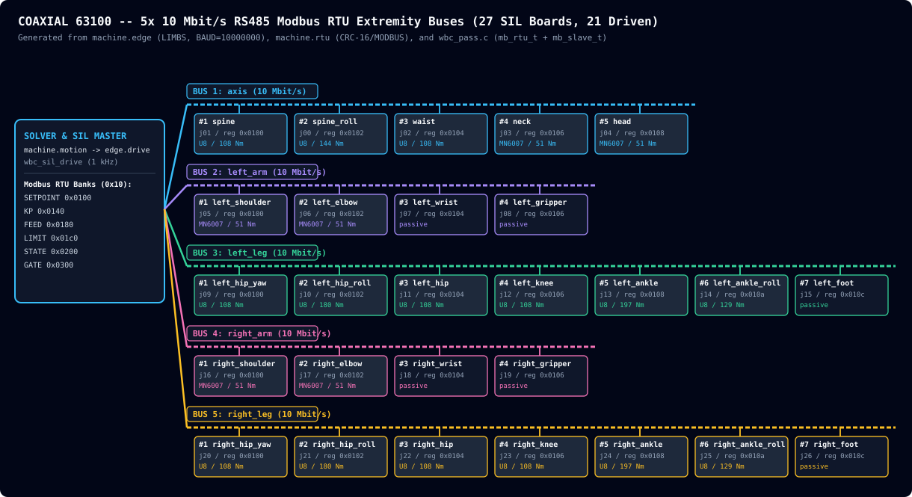

# Architecture: Drivetrain

From the motor to the joint: the PMSM, the drive's law on its board, what
the drive turns through, the drives as bought, the buses their boards
share. A drive's heat: [thermals](thermals.md). Findings:
[drive](../findings/drive.md), [drives](../findings/drives.md),
[stacks](../findings/stacks.md).

| Where | Is |
| --- | --- |
| `motor/` | pmsm (Motor, Parameters, TWO_PI, RAD_S_PER_RPM), catalog (5230SL, BENCH_MOTOR), loads (Propeller), sysid; imports nothing here |
| `drive/` | control law + motor model, portable C11, host-tested: `drive_step(d, in, stage, out)` one PWM period |
| `filter/` | anti-alias biquad chain; designed on the host in `coaxial/acquire/bessel` |
| `ctrl/` | machine.parts and a feedback in C, rows played; `ctrl_loop.c` that loop on a drive, device 12, ticked in the drive's sample - the part's (`board_ctrl.c`) and a stand-in's; host-tested |
| `coaxial/model/` | inverter (the power stage's numbers), sensorless (what the measurements buy), blocks (the control loops as sim blocks around `motor.pmsm`) |
| `coaxial/control/` | motion, commission, identify: procedures on a rig |
| `coaxial/kalman/observer` | the rotor observers, and which motor they watch |
| `host/tools/sim/` | the drive core on this host: montecarlo, observer_run |
| `host/tools/cores/drive.py` | the drive core's ctypes harness |

## machine/

| Module | Is |
| --- | --- |
| drives | two motors as bought, one box, one board; each joint's drive and where it sits, the parts her build's file names |
| mechatronics | the parts library (`library/`: motors, gearboxes, inverters) and a robot's build of it (`robots/`), as TOML |
| servos | each drive kind's servo - peak, stiffness, damping, armature - of her build's file |
| gearbox | each drive's gearbox: the rotor free across its play, the box wound up past it, the link turned |
| linkage | the transmissions off a joint's axis: the ankle's rods, the trunk roll's four-bar, spurs, belts |
| rtu | Modbus RTU: CRC-16, a pass's frames |
| buses | the boards on a bus a limb, a process each in lockstep with the world over a shared block, the host's frames bytes on a socket a bus |
| edge | the 5 extremity 10 Mbit/s RS485 Modbus RTU SIL buses (`LIMBS`, `BAUD`) and their live topology diagram (`bus_layout_svg`) |

## Extremity RS485 Modbus RTU Bus Topology

