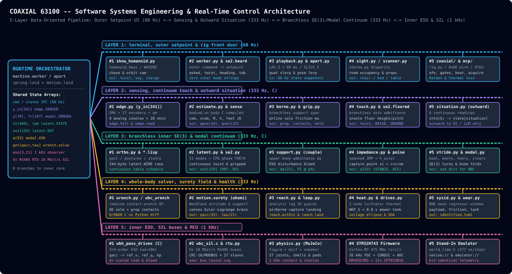

# Architecture: Robotics

The executive any robot here runs on, and the gynoid round its loop
([planners](planners.md)): its build, its world, its senses, the run, its
identification. The robot's figure: [kinematics](kinematics.md); its drives:
[drivetrain](drivetrain.md). Findings by subject:
[FINDINGS](../FINDINGS.md#subjects).

## The executive

`machine/`: any board family, no import of one.

| Module | Is |
| --- | --- |
| roles | Input, Stream, Output, Controller; Part: Filter, Estimator, Regulator |
| errors | the library's exceptions |
| controller | a Loop of Feedbacks over float channels |
| cyclic | that pass data-oriented: a frame, the parts as steps over rows, one edge |
| parts, panel, wiring | the parts, the panel, their wiring |
| ansi | the palette |
| sequencer | lines or tables: a step waits for its targets or tests, its time a timeout; jumps, routines; check, summary |
| alarms | L H logged; LL HH and stop() trip; the sequencer's hooks |
| nodes | Node, Nodes, FAMILIES |
| machine | Machine, Actuator, fit; node_hz: a feedback its node runs, the host forwarding |
| modes | where a machine's boards run: the hardware, a stand-in, their images emulated, or none; the tiers its page affords in real time by the machine's cores (`TIERS`, `chosen`), the page's BUSES box saying which runs and its headroom |
| routines | types: a body of subsystems, a bus each |
| live | fed a line at a time, a buffer, woken with a line, a failsafe |
| simulated | pack, camera |
| virtual | VIRTUAL: a type's joints where told, no board |
| dynamic | a body with mass as a Machine's nodes: a drive a joint, the pelvis's pose (`machine.world.physics`) |

## The gynoid

| Module | Is |
| --- | --- |
| build | the build as made: carbon-fibre shells over the shape, what they hold, the drives where they sit |
| physics | DYNAMIC: the figure in MuJoCo, a drive a joint |
| room | its glazed mountain lodge: timber walls, a glass gable with the door in it, a roof under snow, a deck with its glass rail and a stone terrace a step up, a loft stair; the furniture, a lamp |
| floor | the slab, a sill, a patch, a rug, a stair, bricks, a board; a scene's lay (`lay`), its grounds the lodge's deck and stairs among them |
| sight | humanoid robot eyes: a stereo pair on humanoid robot head, the disparity by block matching, the map it keeps, its things, humanoid robot way round them |
| stereo | the stereo disparity on the card (wgpu or cupy) or the CPU: block matching over DISPARITIES |
| camera | its fake camera: its eye's frames shot where the world runs, the renderer's parallax; its map kept in a process of its own, its things a look later |
| classes | what its eyes take a thing for, the text's semantic classifier: a look that tells it alone its class - a door, a bed, a lamp, a switch -, a material's thing by its box against its figure and the text's slabs and kernels - by its top a floor, a stair, a step, a platform, a sofa, a chair, a table, a bench, a stool, a cabinet, a shelf; by its faces a window and the posts framing it, a railing, a ceiling, a wall, a post -, a chair's back, a leg or a face under a top the top's; a door's or a bed's look where its box bears it out; a building its shell - walls, windows and doors joined or in one plane - with an opening in it, a cabin of one storey else a house, outside it a veranda or a terrace by it and the ground; many to one, what is of one thing one - a window's panes and posts, a stair's treads, a wall either side of its openings -, two chairs side by side two; its registry's slots by it, its panel a thing once, and its picture: its map's things, the floor and the ground under it and what lies past its reach lumped by look, each thing outlined once, a building seen from outside outlined |
| gimbal | a camera on a stabilised gimbal: its sight the world's, leant a little into a turn |
| edge | the one reader of the world for its law - IMU, encoders, sole loads, a skin a segment, insoles - and the one writer of its drives |
| estimate | its pelvis's place and speed of what it measures: the IMU carried, drawn to its bearing insoles; how fast they slide |
| grip | each sole's floor friction as it feels it: what a sliding sole uses |
| touch | what its skin and soles feel, with no branch: upper-body admittance yield, sole trip clearance and continuous twist gating |
| borne | what bears the body off its soles as its skin feels it: the law's support, the step's contacts |
| situation | where it is, projected outward from its continuous sensors and modal state to telemetry (`state['situation']`) |
| motion | its branchless inner law's pass on its sensors alone: sensed, latent, impedance, wrench (or wbc), directional surety and the drives' observers |
| waits | the rows of its table that wait a pass - halting its rhythm while its capture point steps it, raising it while something bears it, lowering it while nothing does - and those that wake its rhythm; in C bit for bit |
| sprung | the latent loop run: its world read and told through its edge, its law's pass between; its process, paced to the clock: the one thing that moves it |
| gait | its standard gait and its modifiers: the walk's parameters as the lisp's streams fold them, moved by named amounts (pace, stride, swing, sway, roll, turn, rock, crouch, lean, width): a gait take's, a catwalk's roll |
| patch | a transition on its loop: lisp read as forms, a morph as contiguous curve rows on the bar grid, begun locked to its double support |
| dsp | the ortho-DSP suite (lisp/humanoid/suite/), the dual-domain kernel's (lisp/humanoid/kernel/, its ops' mechanisms `kernel`) and the runway's dialect evaluated to gaits: their stages, transitions and maneuvers' acts in order |
| maneuver | the suite's maneuvers as its texts: a stunt's patch played on the one it rises from, its acts its phases, each paced to its springs, its arms held; a preload before a cross-fade onto its soles pans what bears it and its legs' springs to them; the bed's patches read, not played |
| acts | the suite's acts as phases of its text (`maneuver`): an envelope's knee its height, a seat's landing (`seated`), a cross-fade the furniture taking it, a cascade or a gate a node a phase, a recline its trunk's ramp, a pendulum refused past its modes' reach |
| seated | its legs and centre of mass sat or sitting down: the knee and ankle a seen seat asks, where they put its centre of mass |
| furniture | what its eyes tell its of a thing a verb goes to: its top, its near edge, its centre |
| route | its way round the furniture to an errand's dock: what stands on its floor grown by its radius on its map's cells, A* through the rest, its corners rounded on the widest arc it free cells and its legs give, walked at its turn times its radius, braked into it; each errand's dock |
| curves | the suite's curves as shares of the way, and as quintics for a row's blend |
| swing | a sole that does not stand: where its modes put it, or at rest on the floor while something bears it |
| voicing | a gait voiced on its walk's row by its changes off the nominal; what has no voice named, what it cannot do refused by name |
| tune | the autotuner's text (meta_ast_autotuner.lisp) on its texts, the suite's and its gym's given as an argument: its grammar, each literal a root reaches where it stands (its gym's by the slot its clause lays), what each moves of it by evaluation, the damped least-squares step, the texts spliced |
| rcu | its loop and a tuner apart with no lock: rings of its passes, a double bank of tables in 64-byte lines (SoA), a seqlock and a took word between them; its loop's side C (wbc_rcu.h), the block locked in memory |
| observer | its generalized momentum observer, blind, in C (wbc_gmo.c): its drives' torques, encoders and IMU over its chain's M(q), at the kernel's 35 Hz, split over the kernel's patches by four least squares, each normal pushing; a pass over its working set alone (working_envelope_scoper.lisp): the unknowns that can push, its capsules' pairs staged within the text's envelope, the same bits as the whole |
| kernel | the dual-domain kernel's ops by the mechanism each feeds; its texts read and their stages' defaults |
| capsules | the kernel's 18 capsules by its names and pairs on its skin, their clearances in closed form and their log-sum-exp, each pair's and each capsule's evading joints (the text's barriers', its synergies') |
| schema | its shield: its posture's ask held to each near pair's ECBF, least in its mass's metric on the pair's evading joints, within their peaks, the rest spilled; its things as the room's boxes, laid once a refresh |
| registry | its map of the room's things: the kernel's 256 slots filled by its looks (its eyes' or their stand-in), matched in the Wasserstein metric over a thing's own size, filtered in, weighed by the text's log-odds in and out of its eyes' frustum, blind spots kept 45 s and swollen, movables diffused, a mover tracked at its velocity; its buses' boxes the slots at its salience |
| somatic | the kernel's Step 4 on its loop: each leg's reach, hip to sole over its leg's length, rolling its sole's centre of pressure onto its ball from 0.86 to 0.98 of it by the furniture's told share; what bears it off its soles capped at its told share of its weight, at the slide regime its text names (`ortho.SLIDE`: 0.55 deeper, 0.70 forward), never under the lever's rule |
| rounds | the step's unknowns' layout and its rounds' clips, as wbc_rounds.c: a sole's cone, a contact's push within GROW_N of what it bears and its cap, its friction kinetic against a slip felt past SLIDE_M_S along the slide its text says, the faces a wrench is past, what the floor cannot give taken by its inertia striding |
| wayfinder | the kernel's wayfinder's gauge: its trunk twisted through the gap its route meets 0.6 s on among what its high band meets |
| bemf | its drives' torque bounds under their back-EMF: the kernel's quadrant law on its DC link's volts, its boards' current loops' own |
| shrunk | its step's answer inside its drives' bounds (wbc_shrunk.c): each drive's box, its clamp as derated within its back-EMF bounds, an ask shrunk as one into it |
| margin | the insert's discrete phase margin: its loop's return ratio at the kernel's four probe frequencies by a first-order quadrature lock-in, each in its turn; the kernel's rollback of K_d and gamma |
| lowering | the kernel's AST-to-SoA lowering: a gait folded into a bank of its ABI over its nominal's (wbc_soa.h: the text's fields at its offsets, a biquad a node seeded on its value, the manifolds' weights, the capsules), carried as an rcu table's words; its loop's biquad in C |
| barrier | its capture point's barrier: its centre of mass's ask held to each support edge's h' + gamma h >= 0 over what bears it, as far as its rows lean on what it does not feel |
| dclink | its DC link: its packs and its boards' capacitance under its drives' power, the boards' d-axis bleed past the text's onset |
| field | its pelvis's blind seek: where its rows wait on a seat not bearing it, its height seeks down at the text's speed through its virtual mass and damping |
| inekf | its pelvis by a right-invariant EKF on SE_2+2(3) beside its estimate: its IMU's pass means, its soles' rolling contact points weighted by the observer |
| tap | its loop's side of a tuner: its raw passes copied (its contacts in C, `wbc_pass_tapped`), cooked and measured on the tuner's core, a table laid at its barrier (lateral crossing, both soles locked, its last blend done) blended minimum-jerk |
| takes | the mocap takes as rows for its loop: a posture take's voices at its beats, a gait take's amounts on its standard gait, entered over its leg's half period, told by the bench |
| worker | its outer loop and session: discrete commands mapped to continuous setpoints, each logged with its epoch and pass, falls recovered; the page's states |
| tour | the scenes one after another, commanded as an agent commands them |
| sysid | its body identified of its edge alone: Newton-Euler down its tree, the base parameters; its pelvis's rows off its insoles or a load cell |
| campaign | the stand's campaign; each gearbox and rotor read |
| wear | its drift and a load off its rows on-line; bands, alarms, service |
| identified | its corrections over its build: the least move of its links and drives that fits a campaign, TOML, laid over its law's model whole |

- `host/tools/sim/`: look (a HUMANOID recording a stage a row); replay (a
  recording's commands run again, pass for pass); scenarios (each scene
  placed, commanded and judged, a table); stunts (the mocap takes as
  scenarios: a move's measures from joints' places, a take's and its own
  alike, the takes' kept in tests/takes/stunts.json); sysid (its identification
  campaign on the stand, tabled, its corrections written); strides, normal,
  looks (a walk's measures, a woman's band, humanoid robot form); identify (a
  take as an ortho-DSP modifier against its walk, numpy alone); suite (the
  suite's patches and the takes' modifiers played on it, measured by it);
  told (its scenarios, each alone on its loop as the page runs it); house
  (its errands from every spot of the lodge, said as F says them).

## Suites

| Suite | Holds |
| --- | --- |
| `test_gynoid.py` | the body on fantasy boards (`physics.ENVELOPE` 0, their SOA never binding): clothes, look, a leg by its foot, a virtual and a dynamic machine, the skeleton, the drives' mounts and gearboxes, kinematics as motors |
| `test_sight.py` | the stereo against the renderer's depth; a look round, posed standing, into humanoid robot map against the room, the chair and the table told, a way planned clear; the page's picture |
| `test_camera.py` | a look round on its fake camera's frames, the furniture told where it stands; its map apart telling what its map here does; its loop under SIGHT on it; what its eyes take things for: a house's things by their boxes and what is of one thing, the lodge as a house, a cabin from outside, the lodge from its deck, each thing once, its registry's slots keeping each one's class, its picture past its map |
| `test_dsp.py` | the ortho-DSP suite read as written, the kernel read whole, a patch voiced on its walk by its changes, a gallop, a sprint and a carioca refused by name, the runway's dialect alike, its walk converted against itself its walk |
| `test_kernel.py` | the dual-domain kernel on its loop: its momentum observer against its skin walking and seated; its chest's yaw leaking nothing standing; what bears it weighed as felt; the capture point's barrier; a pulled chair; the observer's working set scoped as whole, bit for bit, walking and crouched |
| `test_tune.py` | the autotuner's text read; its texts given play as its files; every literal walked where it stands, its gym's by its slot; each one's reach on it - the runway's, the sit's, its walk's -; its step a QP; a run's residuals and the verdicts on a step; a link's rings and banks, its walk linked as unlinked bit for bit, its raw passes cooked as MuJoCo reads them, its walk measured at runtime with its loop apart, a table laid at its barrier blending C2 |
| `test_floor.py` | humanoid robot floor: the plane under humanoid robot soles, its grip as it feels it, the situations that cap humanoid robot rhythm |
| `test_situation.py` | humanoid robot situation: the text's bounds and caps, each entered unannounced told within a second |
| `test_gvs.py` | the measures' dimensionless frame (Hof), SO(3)'s geodesic, the gates on them (`tools/sim/gvs.py`) |
| `test_scenarios.py` | humanoid robot scenarios that hold (`tools/sim/scenarios.py`): a scene placed, commanded as a player would, its goal met by the world's truth |
| `test_replays.py` | humanoid robot runs recorded on the page (`tests/replays`), each command at its pass, none ending in a fall; the falls still open in `tests/replays/falls` |
| `test_sysid.py` | its identification: drives, links, a payload, boxes, rotors; corrections; a world 15 % off; a harness |
| `test_wear.py` | on-line: a load read walking, a knee's friction and a hip's torque named; a box's play |
| `test_errands.py` | errands: a stop settles, F heard, a new scene walked |
| `test_sysid_live.py` | its identification off the stand: its model held to its walk on a world off the figure; its weight and its moments standing on its insoles |
| `test_compiled.py` | its numpy compiled to C (`tools.cores.bodied`) beside numpy's own: its reductions and ties of zeros, its state in place, its sensing at random configurations, its law's compiled parts at every pass walking |
| `test_ported.py` | its law's hand ports in C beside their python at every pass of its walk, bit for bit: its surety field, its touch's filter, its twist's step, its table's waits, its brace on the solve; each step's time |

## Software Systems Engineering Architecture

All inner control, contact and observer modules (`motion`, `touch`, `grip`,
`se2`, `latent`, `modal`, `impedance`, `swing`, `poise`, `stride`, `support`, `borne`,
`wrench`) operate as a branchless physical and mathematical continuum on SE(3)
and modal vectors without conditional logic (`if`-statements, mode-string
branches or discrete thresholds). External commands enter through the outer
setpoint loop (`worker`, `se2.heard_twist`), and discrete situation labels are
projected strictly outward (`situation` -> `state['situation']`) for telemetry
and external planners.

