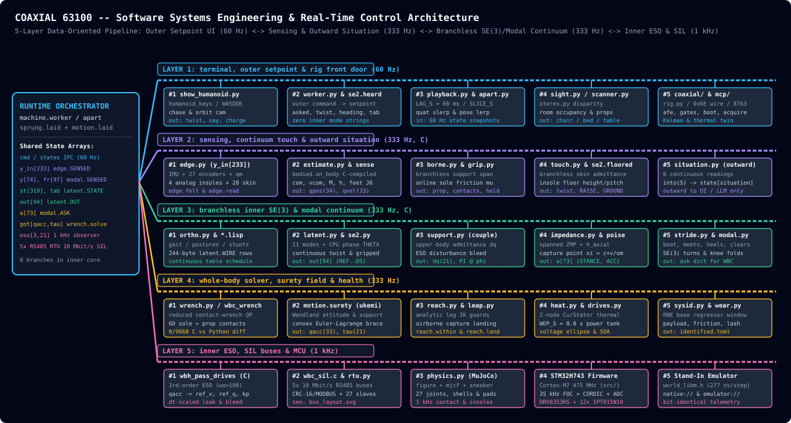

# Architecture: Robotics

The executive any robot here runs on, and the gynoid round her loop
([planners](planners.md)): her build, her world, her senses, the run, her
identification. Her figure: [kinematics](kinematics.md); her drives:
[drivetrain](drivetrain.md). Findings by subject:
[FINDINGS](../FINDINGS.md#subjects).

## The executive

`machine/`: any board family, no import of one.

| Module | Is |
| --- | --- |
| roles | Input, Stream, Output, Controller; Part: Filter, Estimator, Regulator |
| errors | the library's exceptions |
| controller | a Loop of Feedbacks over float channels |
| cyclic | that pass data-oriented: a frame, the parts as steps over rows, one edge |
| parts, panel, wiring | the parts, the panel, their wiring |
| ansi | the palette |
| sequencer | lines or tables: a step waits for its targets or tests, its time a timeout; jumps, routines; check, summary |
| alarms | L H logged; LL HH and stop() trip; the sequencer's hooks |
| nodes | Node, Nodes, FAMILIES |
| machine | Machine, Actuator, fit; node_hz: a feedback its node runs, the host forwarding |
| modes | where a machine's boards run: the hardware, a stand-in, their images emulated, or none; the tiers her page affords in real time by the machine's cores (`TIERS`, `chosen`), the page's BUSES box saying which runs and her headroom |
| routines | types: a body of subsystems, a bus each |
| live | fed a line at a time, a buffer, woken with a line, a failsafe |
| simulated | pack, camera |
| virtual | VIRTUAL: a type's joints where told, no board |
| dynamic | a body with mass as a Machine's nodes: a drive a joint, the pelvis's pose (`machine.physics`) |

## The gynoid

| Module | Is |
| --- | --- |
| build | the build as made: carbon-fibre shells over the shape, what they hold, the drives where they sit |
| physics | DYNAMIC: the figure in MuJoCo, a drive a joint |
| room | her glazed mountain lodge: timber walls, a glass gable with the door in it, a roof under snow, a deck with its glass rail and a stone terrace a step up, a loft stair; the furniture, a lamp |
| floor | the slab, a sill, a patch, a rug, a stair, bricks, a board; a scene's lay (`lay`), her grounds the lodge's deck and stairs among them |
| sight | humanoid robot eyes: a stereo pair on humanoid robot head, the disparity by block matching, the map she keeps, its things, humanoid robot way round them |
| stereo | the stereo disparity on the card (wgpu or cupy) or the CPU: block matching over DISPARITIES |
| gimbal | a camera on a stabilised gimbal: its sight the world's, leant a little into a turn |
| edge | the one reader of the world for her law - IMU, encoders, sole loads, a skin a segment, insoles - and the one writer of her drives |
| estimate | her pelvis's place and speed of what she measures: the IMU carried, drawn to her bearing insoles; how fast they slide |
| grip | each sole's floor friction as she feels it: what a sliding sole uses |
| touch | what her skin and soles feel, with no branch: upper-body admittance yield, sole trip clearance and continuous twist gating |
| borne | what bears the body off its soles as its skin feels it: the law's support, the step's contacts |
| situation | where she is, projected outward from her continuous sensors and modal state to telemetry (`state['situation']`) |
| motion | her branchless inner law's pass on her sensors alone: sensed, latent, impedance, wrench (or wbc), directional surety and the drives' observers |
| waits | the rows of her table that wait a pass - halting her rhythm while her capture point steps her, raising her while something bears her, lowering her while nothing does - and those that wake her rhythm; in C bit for bit |
| sprung | the latent loop run: her world read and told through her edge, her law's pass between; her process, paced to the clock: the one thing that moves her |
| takes | the mocap takes as rows for her loop: a take's posture modes at its frames, entered over her leg's half period, told by the bench |
| worker | her outer loop and session: discrete commands mapped to continuous setpoints, each logged with its epoch and pass, falls recovered; the page's states |
| tour | the scenes one after another, commanded as an agent commands them |
| sysid | her body identified of her edge alone: Newton-Euler down her tree, the base parameters; her pelvis's rows off her insoles or a load cell |
| campaign | the stand's campaign; each gearbox and rotor read |
| wear | her drift and a load off her rows on-line; bands, alarms, service |
| identified | her corrections over her build: the least move of her links and drives that fits a campaign, TOML, laid over her law's model whole |

- `host/tools/sim/`: look (a HUMANOID recording a stage a row); replay (a
  recording's commands run again, pass for pass); scenarios (each scene
  placed, commanded and judged, a table); stunts (the mocap takes as
  scenarios: a move's measures from joints' places, a take's and hers
  alike, the takes' kept in tests/takes/stunts.json); sysid (her identification
  campaign on the stand, tabled, its corrections written); strides, normal,
  looks (a walk's measures, a woman's band, humanoid robot form).

## Suites

| Suite | Holds |
| --- | --- |
| `test_gynoid.py` | the body on fantasy boards (`physics.ENVELOPE` 0, their SOA never binding): clothes, look, a leg by its foot, a virtual and a dynamic machine, the skeleton, the drives' mounts and gearboxes, kinematics as motors |
| `test_sight.py` | the stereo against the renderer's depth; a look round, posed standing, into humanoid robot map against the room, the chair and the table told, a way planned clear; the page's picture |
| `test_floor.py` | humanoid robot floor: the plane under humanoid robot soles, its grip as she feels it, the situations that cap humanoid robot rhythm |
| `test_situation.py` | humanoid robot situation: the text's bounds and caps, each entered unannounced told within a second |
| `test_gvs.py` | the measures' dimensionless frame (Hof), SO(3)'s geodesic, the gates on them (`tools/sim/gvs.py`) |
| `test_scenarios.py` | humanoid robot scenarios that hold (`tools/sim/scenarios.py`): a scene placed, commanded as a player would, its goal met by the world's truth |
| `test_replays.py` | humanoid robot runs recorded on the page (`tests/replays`), each command at its pass, none ending in a fall; the falls still open in `tests/replays/falls` |
| `test_sysid.py` | her identification: drives, links, a payload, boxes, rotors; corrections; a world 15 % off; a harness |
| `test_wear.py` | on-line: a load read walking, a knee's friction and a hip's torque named; a box's play |
| `test_errands.py` | errands: a stop settles, F heard, a new scene walked |
| `test_sysid_live.py` | her identification off the stand: her model held to her walk on a world off the figure; her weight and its moments standing on her insoles |
| `test_compiled.py` | her numpy compiled to C (`tools.cores.bodied`) beside numpy's own: its reductions and ties of zeros, her state in place, her sensing at random configurations, her law's compiled parts at every pass walking |
| `test_ported.py` | her law's hand ports in C beside their python at every pass of her walk, bit for bit: her surety field, her touch's filter, her twist's step, her table's waits, her brace on the solve; each step's time |

## Software Systems Engineering Architecture

All inner control, contact and observer modules (`motion`, `touch`, `grip`,
`se2`, `latent`, `modal`, `impedance`, `poise`, `stride`, `support`, `borne`,
`wrench`) operate as a branchless physical and mathematical continuum on SE(3)
and modal vectors without conditional logic (`if`-statements, mode-string
branches or discrete thresholds). External commands enter through the outer
setpoint loop (`worker`, `se2.heard_twist`), and discrete situation labels are
projected strictly outward (`situation` -> `state['situation']`) for telemetry
and external planners.

